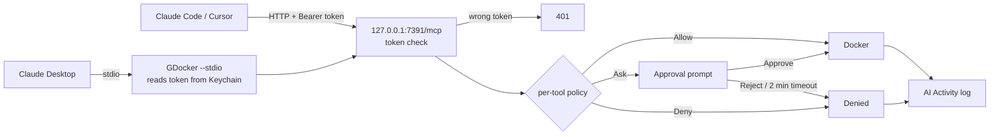

<div align="center">

# 🐳 GDocker

**A native macOS Docker UI with a built-in, permission-gated MCP server.**

Manage containers, images, volumes, networks, and Compose projects with a fast SwiftUI interface inspired by [lazydocker](https://github.com/jesseduffield/lazydocker) — and let AI clients (Claude Code, Claude Desktop, Cursor, and more) inspect or control Docker strictly under rules you approve.

[](Package.swift)
[](scripts/Info.plist)
[](https://github.com/Diaszano/gdocker/actions/workflows/ci.yml)
[](LICENSE)
[](https://conventionalcommits.org)
[](https://github.com/Diaszano/gdocker/releases/latest)

---

**Languages:** 🇺🇸 **English** • [🇧🇷 Português](README.pt-BR.md)

English is the source language for public documentation. Brazilian Portuguese translations use the `.pt-BR.md` suffix.

</div>

<!-- TODO screenshot: add docs/assets/screenshot-light.png and docs/assets/screenshot-dark.png (~1600x1000, Containers tab), then replace this comment with:
<p align="center"><picture><source media="(prefers-color-scheme: dark)" srcset="docs/assets/screenshot-dark.png"></picture></p> -->

---

## 📖 Table of Contents

- [Core Features](#-core-features)
- [Requirements](#-requirements)
- [Installation](#-installation)
- [Connect an AI Client (MCP)](#-connect-an-ai-client-mcp)
- [MCP Permissions](#-mcp-permissions)
- [Build from Source](#-build-from-source)
- [Documentation & Guides](#-documentation--guides)
- [Contributing](#-contributing)
- [Security](#-security)
- [License](#-license)

---

## ✨ Core Features

- **Containers & Compose grouping:** View containers grouped by Compose project with status filters, resizable columns, service brand logos, and quick start, stop, restart, and remove actions.
- **Container inspector:** Live filterable logs with timestamps, real-time CPU/memory/network stats, raw inspect JSON, environment variables, and an interactive terminal powered by SwiftTerm.
- **Images, Volumes, Networks & Compose:** Inspect, remove, prune, run `compose up`/`down`, and open Docker volumes directly in Finder via a local WebDAV mount (`GDocker.local`).
- **Runtime overview & Menu bar popover:** Monitor Docker runtime CPU, memory, and disk usage from the sidebar `RuntimeCard` or an optional Catppuccin-themed menu bar popover.
- **Broad runtime support:** Works with **Docker Desktop**, **OrbStack**, **Colima**, and **Rancher Desktop**.
- **Built-in MCP server:** Binds strictly to `127.0.0.1` with a Keychain-backed bearer token, per-tool **Allow / Ask / Deny** policies, interactive approval prompts, and a full **AI Activity** audit log.
- **Native macOS polish:** English and Brazilian Portuguese localization, Catppuccin light/dark themes, and zero Electron overhead.

---

## 📋 Requirements

- **macOS 14 (Sonoma)** or later (Apple Silicon & Intel universal binary)
- **Docker Desktop**, **OrbStack**, **Colima**, or **Rancher Desktop** running locally
- The `docker` CLI on your `PATH` (for Compose operations and the interactive Terminal tab)

---

## 📦 Installation

### Via Homebrew (Recommended)

```sh
brew trust --cask diaszano/tap/gdocker
brew install --cask diaszano/tap/gdocker
```

> [!NOTE]
> GDocker is ad-hoc signed rather than Apple-notarized. The Homebrew Cask removes the quarantine flag automatically during installation. If you download the `.zip` manually from [Releases](https://github.com/Diaszano/gdocker/releases), run:
>
> ```sh
> xattr -dr com.apple.quarantine /Applications/GDocker.app
> ```
>
> Because each release has a new ad-hoc signature, macOS will ask for your login password once per version so GDocker can read its MCP token from the Keychain — choose **Always Allow**.

See [docs/installation.md](docs/installation.md) for full installation, upgrade, and uninstall instructions.

---

## 🤖 Connect an AI Client (MCP)

Start the MCP server from **Permissions** in the sidebar (or enable *Start the MCP server when the app opens* in Settings), then click **Copy config**:

- **Claude Code (HTTP):**
  ```sh
  claude mcp add --transport http gdocker http://localhost:7391/mcp --header "Authorization: Bearer <token>"
  ```
- **Generic `mcpServers` JSON (HTTP):** Ready-to-paste snippet for Cursor and other HTTP MCP clients.
- **Claude Desktop (`--stdio` bridge):** The app binary doubles as a stdio bridge that forwards to the running GDocker app and reads the bearer token from Keychain:
  ```json
  {
    "mcpServers": {
      "gdocker": {
        "command": "/Applications/GDocker.app/Contents/MacOS/GDocker",
        "args": ["--stdio"]
      }
    }
  }
  ```

GDocker must be open for AI clients to connect. Port `7391` is the default and can be changed in Settings. See [docs/mcp.md](docs/mcp.md) for complete MCP documentation.

---

## 🔐 MCP Permissions

Every tool call passes the token check and then the per-tool policy before it reaches Docker:



| Default | Tools |
| --- | --- |
| **Allow** | `list_containers`, `inspect_container`, `get_logs`, `get_stats`, `list_images`, `list_volumes`, `list_networks`, `list_compose_projects`, `start_container`, `restart_container` |
| **Ask** | `get_container_env`, `stop_container`, `exec_in_container`, `compose_up`, `compose_down`, `remove_container` |
| **Deny** | `remove_image`, `remove_volume`, `remove_network`, `system_prune` |

- Environment variable values are masked (`***`) everywhere except `get_container_env`.
- An `exec_in_container` approval covers only that exact command and never offers *Always allow*.
- Unanswered approval prompts are automatically denied after 2 minutes.

---

## 🛠️ Build from Source

Requires **Xcode 16.4+** (Swift 6.1+) and **SwiftLint** (`brew install swiftlint`) for full verification.

```sh
make hooks   # enable commit-msg and pre-push hooks (Conventional Commits + branch names)
make verify  # run fmt-check, SwiftLint, l10n check, and swift test
make app     # build build/GDocker.app
make run     # build and open GDocker.app
```

*(Docker-dependent integration tests skip automatically when no local Docker daemon is running.)*

---

## 📚 Documentation & Guides

- [Installation Guide](docs/installation.md) ([PT-BR](docs/installation.pt-BR.md))
- [MCP Server & AI Clients](docs/mcp.md) ([PT-BR](docs/mcp.pt-BR.md))
- [Security Architecture](docs/security.md) ([PT-BR](docs/security.pt-BR.md))
- [Changelog](CHANGELOG.md)
- [Contributing](CONTRIBUTING.md)
- [Security Policy](SECURITY.md)

---

## 🤝 Contributing

Contributions are welcome! Please read [CONTRIBUTING.md](CONTRIBUTING.md) for development setup, localization checks, and PR guidelines.

Commits must follow [Conventional Commits](https://www.conventionalcommits.org/) and branches must follow [Conventional Branch](https://conventional-branch.github.io/) (`feat/volume-search`, `fix/socket-discovery`); CI enforces both. Releases are automated: [release-please](https://github.com/googleapis/release-please) turns merged commits into a version bump, a [CHANGELOG](CHANGELOG.md) entry, a GitHub Release, and a Homebrew Cask update.

---

## 🛡️ Security

To report a security vulnerability privately, please follow [SECURITY.md](SECURITY.md).

---

## 📄 License

Licensed under the [MIT License](LICENSE).
