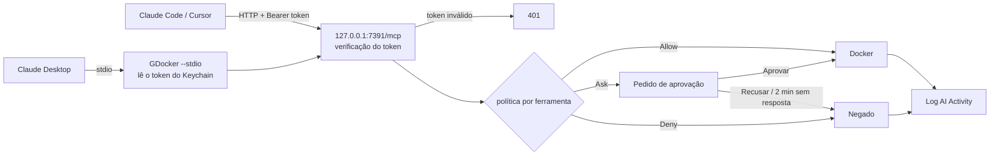

<div align="center">

# 🐳 GDocker

**Uma interface nativa para Docker no macOS com servidor MCP integrado e controle de permissões.**

Gerencie containers, imagens, volumes, redes e projetos Compose com uma UI rápida em SwiftUI inspirada no [lazydocker](https://github.com/jesseduffield/lazydocker) — e permita que clientes de IA (Claude Code, Claude Desktop, Cursor e outros) inspecionem ou controlem o Docker apenas sob regras aprovadas por você.

[](Package.swift)
[](scripts/Info.plist)
[](https://github.com/Diaszano/gdocker/actions/workflows/ci.yml)
[](LICENSE)
[](https://conventionalcommits.org)
[](https://github.com/Diaszano/gdocker/releases/latest)

---

**Idiomas:** [🇺🇸 English](README.md) • 🇧🇷 **Português**

O inglês é o idioma fonte da documentação pública. Traduções em português brasileiro usam o sufixo `.pt-BR.md`.

</div>

<!-- TODO screenshot: adicionar docs/assets/screenshot-light.png e docs/assets/screenshot-dark.png (~1600x1000, aba Containers) e trocar este comentário por:
<p align="center"><picture><source media="(prefers-color-scheme: dark)" srcset="docs/assets/screenshot-dark.png"></picture></p> -->

---

## 📖 Sumário

- [Principais Recursos](#-principais-recursos)
- [Requisitos](#-requisitos)
- [Instalação](#-instalação)
- [Conectar um Cliente de IA (MCP)](#-conectar-um-cliente-de-ia-mcp)
- [Permissões MCP](#-permissões-mcp)
- [Compilar a partir do Código-Fonte](#-compilar-a-partir-do-código-fonte)
- [Documentação e Guias](#-documentação-e-guias)
- [Contribuindo](#-contribuindo)
- [Segurança](#-segurança)
- [Licença](#-licença)

---

## ✨ Principais Recursos

- **Containers e agrupamento Compose:** Visualize containers agrupados por projeto Compose com filtros de status, colunas redimensionáveis, logos de serviços e ações rápidas de iniciar, parar, reiniciar e remover.
- **Inspetor de container:** Logs em tempo real com filtro e timestamps, estatísticas de CPU/memória/rede, JSON de inspeção, variáveis de ambiente e terminal interativo via SwiftTerm.
- **Imagens, Volumes, Redes e Compose:** Inspecione, remova, faça prune, execute `compose up`/`down` e abra volumes Docker diretamente no Finder via montagem WebDAV local (`GDocker.local`).
- **Visão do runtime e popover na barra de menus:** Acompanhe CPU, memória e disco do runtime Docker pelo `RuntimeCard` na barra lateral ou pelo popover opcional na barra de menus com tema Catppuccin.
- **Suporte amplo de runtimes:** Funciona com **Docker Desktop**, **OrbStack**, **Colima** e **Rancher Desktop**.
- **Servidor MCP integrado:** Escuta exclusivamente em `127.0.0.1` com token bearer salvo no Keychain, políticas **Permitir / Perguntar / Negar** por ferramenta, prompts interativos de aprovação e histórico completo de **Atividade de IA**.
- **Experiência nativa macOS:** Localização em inglês e português brasileiro, temas Catppuccin claro/escuro e zero overhead de Electron.

---

## 📋 Requisitos

- **macOS 14 (Sonoma)** ou superior (binário universal Apple Silicon e Intel)
- **Docker Desktop**, **OrbStack**, **Colima** ou **Rancher Desktop** em execução localmente
- CLI `docker` no seu `PATH` (para operações Compose e a aba Terminal interativo)

---

## 📦 Instalação

### Via Homebrew (Recomendado)

```sh
brew trust --cask diaszano/tap/gdocker
brew install --cask diaszano/tap/gdocker
```

> [!NOTE]
> O GDocker possui assinatura ad-hoc e não é notarizado pela Apple. O Cask do Homebrew remove o atributo de quarentena automaticamente na instalação. Se você baixar o `.zip` manualmente em [Releases](https://github.com/Diaszano/gdocker/releases), execute:
>
> ```sh
> xattr -dr com.apple.quarantine /Applications/GDocker.app
> ```
>
> Como cada versão recebe uma nova assinatura ad-hoc, o macOS solicitará sua senha de login uma vez por versão para o GDocker ler o token MCP no Keychain — escolha **Sempre Permitir**.

Veja [docs/installation.pt-BR.md](docs/installation.pt-BR.md) para instruções completas de instalação, atualização e remoção.

---

## 🤖 Conectar um Cliente de IA (MCP)

Inicie o servidor MCP em **Permissões** na barra lateral (ou ative *Iniciar servidor MCP ao abrir o app* em Ajustes) e clique em **Copiar config**:

- **Claude Code (HTTP):**
  ```sh
  claude mcp add --transport http gdocker http://localhost:7391/mcp --header "Authorization: Bearer <token>"
  ```
- **JSON genérico `mcpServers` (HTTP):** Snippet pronto para Cursor e outros clientes MCP HTTP.
- **Claude Desktop (ponte `--stdio`):** O próprio executável atua como ponte stdio para o app em execução, lendo o token direto do Keychain:
  ```json
  {
    "mcpServers": {
      "gdocker": {
        "command": "/Applications/GDocker.app/Contents/MacOS/GDocker",
        "args": ["--stdio"]
      }
    }
  }
  ```

O GDocker precisa estar aberto para a IA se conectar. A porta padrão é `7391` e pode ser alterada nos Ajustes. Veja [docs/mcp.pt-BR.md](docs/mcp.pt-BR.md) para a documentação completa.

---

## 🔐 Permissões MCP

Toda chamada de ferramenta passa pela verificação do token e pela política da ferramenta antes de chegar ao Docker:



| Padrão | Ferramentas |
| --- | --- |
| **Permitir** | `list_containers`, `inspect_container`, `get_logs`, `get_stats`, `list_images`, `list_volumes`, `list_networks`, `list_compose_projects`, `start_container`, `restart_container` |
| **Perguntar** | `get_container_env`, `stop_container`, `exec_in_container`, `compose_up`, `compose_down`, `remove_container` |
| **Negar** | `remove_image`, `remove_volume`, `remove_network`, `system_prune` |

- Valores de variáveis de ambiente são mascarados (`***`) em todo lugar, exceto em `get_container_env`.
- A aprovação de `exec_in_container` vale apenas para aquele comando exato e nunca oferece *Sempre permitir*.
- Prompts sem resposta são negados automaticamente após 2 minutos.

---

## 🛠️ Compilar a partir do Código-Fonte

Requer **Xcode 16.4+** (Swift 6.1+) e **SwiftLint** (`brew install swiftlint`) para verificação completa.

```sh
make hooks   # ativa os hooks commit-msg e pre-push (Conventional Commits + nome de branch)
make verify  # executa fmt-check, SwiftLint, check de l10n e swift test
make app     # compila build/GDocker.app
make run     # compila e abre GDocker.app
```

*(Testes de integração que dependem do Docker são ignorados automaticamente quando não há daemon em execução.)*

---

## 📚 Documentação e Guias

- [Guia de Instalação](docs/installation.pt-BR.md) ([EN](docs/installation.md))
- [Servidor MCP e Clientes de IA](docs/mcp.pt-BR.md) ([EN](docs/mcp.md))
- [Arquitetura de Segurança](docs/security.pt-BR.md) ([EN](docs/security.md))
- [Changelog](CHANGELOG.md)
- [Como Contribuir](CONTRIBUTING.md)
- [Política de Segurança](SECURITY.md)

---

## 🤝 Contribuindo

Contribuições são bem-vindas! Leia [CONTRIBUTING.md](CONTRIBUTING.md) para detalhes sobre setup de desenvolvimento, validação de traduções e diretrizes de PR.

Commits seguem [Conventional Commits](https://www.conventionalcommits.org/) e branches seguem [Conventional Branch](https://conventional-branch.github.io/) (`feat/volume-search`, `fix/socket-discovery`); o CI valida os dois. Os releases são automáticos: o [release-please](https://github.com/googleapis/release-please) transforma os commits mergeados em nova versão, entrada no [CHANGELOG](CHANGELOG.md), GitHub Release e atualização do Homebrew Cask.

---

## 🛡️ Segurança

Para reportar uma vulnerabilidade de segurança de forma privada, siga as instruções em [SECURITY.md](SECURITY.md).

---

## 📄 Licença

Licenciado sob a [Licença MIT](LICENSE).
